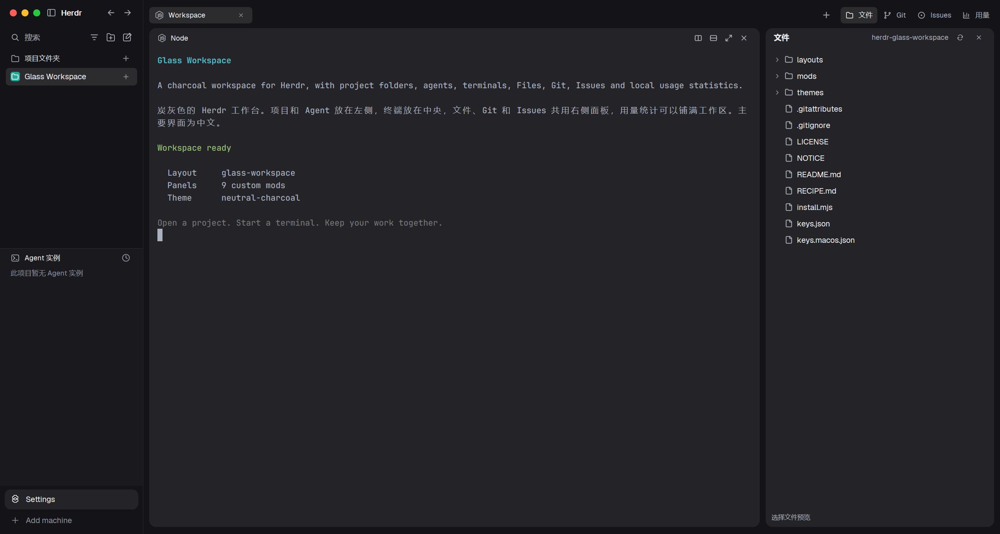

# Glass Workspace

A charcoal workspace for Herdr, with project folders, agents, terminals, Files, Git, Issues and local usage statistics.

炭灰色的 Herdr 工作台。项目和 Agent 放在左侧，终端放在中央，文件、Git 和 Issues 共用右侧面板，用量统计可以铺满工作区。主要界面为中文。



## 安装

需要先安装 [Herdr](https://herdr.dev/download/) 和 Node.js 24 或更新版本。此版本基于 Herdr 0.1.14，已在 Windows 和 Apple Silicon Mac 上检查和试用；Linux 尚未实测。

```sh
git clone https://github.com/axgiroud312-byte/herdr-glass-workspace.git
cd herdr-glass-workspace
node install.mjs
```

安装器会添加布局、9 个面板和配色，识别本机 Node 路径，选择 Windows 或 Mac 快捷键，并逐个运行 Herdr 的面板检查。如果 Herdr 已打开，会切换到“炭灰工作台”。也可以从布局选择器切换，或运行：

```sh
herdr-app do layout.switch --name glass-workspace
```

安装器只合并 `layout:glass-workspace` 的快捷键，不替换全局或终端快捷键。如果电脑已有同名布局、面板或配色，它会停止，请让 Agent 对比后更新或改名。

也可以把下面这段话交给 Agent：

> 阅读 `~/.config/herdr-app/AGENTS.md`，再阅读 https://github.com/axgiroud312-byte/herdr-glass-workspace 的 `RECIPE.md` 和所有面板代码。把 Glass Workspace 添加到我的 Herdr，保留我已有的布局和快捷键，并按当前电脑适配 Node 路径。

## 日常使用

- 左侧“项目文件夹”：打开项目，切换项目，或为该项目启动终端和 Agent。
- 顶部“文件 / Git / Issues”：打开对应的右侧面板；再次点击会收起。
- 顶部“用量”：查看本机 Agent 的使用记录；切换标签或项目会回到终端。
- 终端标题栏：拆分、放大和关闭对应终端；上边缘中央的手柄可以移动窗格。
- Mac 使用 Command 键习惯。布局切换为 Mac 的 `Cmd+Shift+L` 或 Windows 的 `Ctrl+Shift+L`。

## 配套功能需要什么

| 功能 | 需要 | 会做什么 |
| --- | --- | --- |
| 文件 | 当前项目文件夹 | 按需列目录，提供只读预览 |
| Git | Git | 查看状态和差异；点击提交才会执行 `git add -A` 和 `git commit` |
| Issues | GitHub CLI，且已 `gh auth login` | 联网读取当前 GitHub 仓库的 Issue 列表和详情 |
| 用量统计 | Node.js 24+ | 读取本机的 Agent 使用记录，在本机保存统计结果 |

用量统计默认读取 `~/.codex/sessions`、`~/.codex/archived_sessions`、`~/.claude/projects`、`~/.pi/agent/sessions` 和 `~/.local/share/opencode`。可在用量页面的设置中调整来源。金额按随模板附带的价格表估算，价格表有日期，不代表订阅账单。

本仓库只包含界面代码和资源，不附带个人会话、使用记录、账号或密钥。安装器把统计程序的 Node 路径写到安装目录的 `mods/insights/runtime.json`；手动安装时也可以在这里填写本机 Node 路径。

## 文件与来源

`layouts/` 是布局，`mods/` 是配套面板，`themes/` 是配色。`keys.json` 是 Windows/Linux 的布局快捷键片段，`keys.macos.json` 是 Mac 的片段。它们都需要合并到 Herdr 的 `keys.json`，不能整份覆盖。`RECIPE.md` 说明如何从空目录重建这套界面。

软件采用 Apache-2.0 许可证。部分面板由 [Herdr](https://github.com/herdrdev/herdr-app) 的默认面板修改而来，详见 [NOTICE](NOTICE)。
