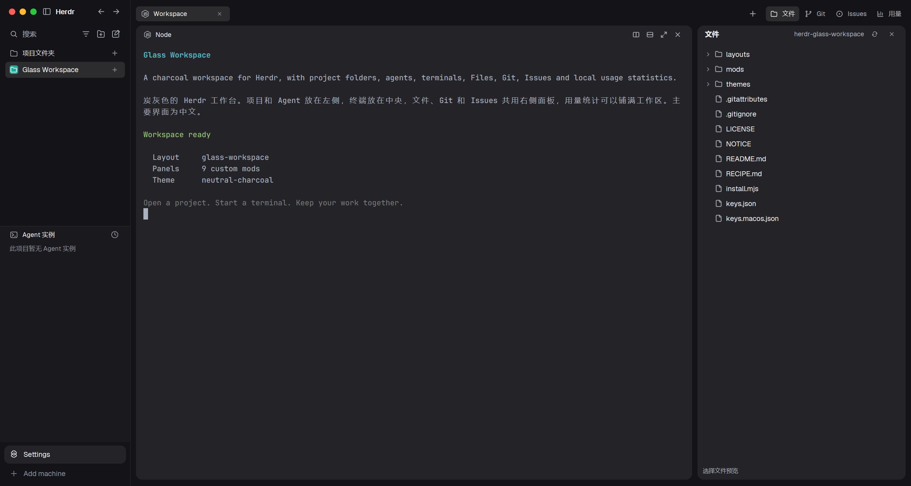

# Glass Workspace

这是一套炭灰色 Herdr 工作台：左侧放项目和当前项目的 Agent，中央放可拆分的终端，右侧在文件、Git、Issues 之间切换，用量统计则使用整块中央区域。文字主要为中文，底部保留 Settings 和 Add machine。布局文件名是 `glass-workspace`，在 Herdr 内显示为“炭灰工作台”。

## What you see

- 整体背景 `#141418`，终端和主要卡片 `#232328`，选中表面 `#2C2C2F`，Agent 区域 `#19191E`。使用 `themes/neutral-charcoal.json` 的 16 色终端配色和语义颜色，不做半透明玻璃效果。
- 左侧固定 244px。最上方 44px 放窗口按钮、Herdr、收起侧栏、前后项目；下一行 40px 放搜索、Agent 排序、新建项目和启动任务。项目与 Agent 两区可拖动分界线，底部 82px 放 Settings 与 Add machine。
- 工作区外边距为纵向 8px、横向 10px。顶部标签栏高 36px，每个任务标签宽 176px、高 28px；右侧依次是新任务、文件、Git、Issues、用量。当操作区宽度小于 880px 时，工具按钮只显示图标。
- 终端卡片圆角 12px，边框 4px，窗格间隔 10px；单个终端也保留卡片。标题栏高 26px，右边是左右拆分、上下拆分、放大、关闭。
- 右侧工具面板初始隐藏，初始宽 390px，允许 160–720px，并会给终端留出空间。文件、Git、Issues 使用同一块 12px 圆角面板。
- 用量页面有概览和请求明细，包含时间范围、估算费用、Token 数量、记录数、模型趋势、模型排行、历史活动及来源设置。
- 字体使用 Herdr 附带的 Geist，终端字号 14px。尺寸均按缩放 1 设计，使用者的全局缩放仍然生效。

## How it behaves

- 项目按钮调用系统文件夹选择器；新终端和拆分终端从记录的项目根目录开始。项目名称、文件和终端内容来自使用者本机。
- 点击项目或任务标签回到终端视图；项目列表可在同一机器内拖动排序，任务标签可在同一项目内交换顺序。双击标签重命名。
- 当前项目的 Agent 单独列在左下方，支持排序、置顶和展开子 Agent。`working` 用原生旋转图标；`blocked` 显示“等待操作”；`done` 显示实心状态点；`idle` 显示空心圆。点击 Agent 定位其终端，子 Agent 可以预览。
- 文件、Git、Issues 按钮再次点击会收起右侧面板。面板选择按项目记住；用量按钮切换到完整统计视图。切换项目、任务或已聚焦的终端会回到终端视图。
- 布局快捷键先离开用量页再导航。关闭、拆分、放大等结构操作在第一次离开用量页时只返回工作区，避免操作看不见的终端；再次按键才执行。
- Git 面板在点击提交时运行 `git add -A` 和 `git commit`；Issues 只读，通过 GitHub CLI 查询。文件预览只读。
- Hover 和选中使用原生颜色/透明度过渡，通常 140ms；列表加入和离开使用 180ms 尺寸过渡。工作状态旋转使用原生动画，不用持续重画的帧计时器。
- Windows 显示自绘的三个窗口按钮；Mac 使用系统按钮，非全屏时给它们留出 76px。侧栏隐藏时，Mac 的顶部任务栏也会留出按钮位置。

## Built from

布局树从 `root` 分成 `sidebar` 和 `workspace-inset`。后者包含 `tabs` 和 `work-views` 栈；栈在 `workspace-view` 与 `usage-view` 之间切换。`workspace-view` 横向包含 `terminal-canvas` 和 `tool-panel`，工具面板内的 `tool-views` 栈包含 `files`、`changes`、`issues`。

| 面板 | 用途与角色 |
| --- | --- |
| `glass-shell` | `brand`、`sidebar-head`、`sidebar-foot`、`tabs` 等角色，处理项目创建、视图和快捷键转发 |
| `shell-spaces` | 项目列表、机器分组、工作树和 Git 状态 |
| `shell-agents` | 当前项目的 Agent、子 Agent、排序、置顶和预览 |
| `shell-pane` | 终端标题栏及作用于对应终端的操作 |
| `shell-new-menu` | 当前项目的新终端、已安装 Agent 和工作树菜单 |
| `shell-files` | 延迟展开的目录树与只读文件预览 |
| `shell-changes` | Git 文件状态、差异和手动提交 |
| `shell-issues` | GitHub Issue 列表、状态、搜索和详情 |
| `insights` | Node 本地采集与分析，Herdr 原生统计界面 |

依赖 Herdr 自带的 `workspace-chrome` 图标，以及 `menu`、`picker`、`confirm`、`machine-add`、`worktree` 等基础面板，保留它们的引用即可。

主要使用 `spaces`、`agents`、`terminals`、`panes`、`focused`、`machines`、`layout`、`theme`、`shared`、`setShared`、`localStorage`、`nextCommand`、`openOverlay`、`run`、`exec`、`hc`、`pickFolder`、`readTextFile` 和 `watchFolder`。UI 由 `gpui-kit`、`gpui-base` 的原生元素组成，没有 HTML 或 CSS。布局操作使用 `layout.select/show/hide/resize`，项目和终端操作使用 `space.*`、`tab.*`、`pane.*`、`terminal.*` 和 `agent.focus`。

外部程序为 Git、GitHub CLI 和 Node。Windows 的本地目录列表使用 PowerShell；Unix 使用 `sh`。用量程序是 `mods/insights/presenter.mjs` 与其同目录模块，本地存储在 Herdr 的 `data/insights/`。安装器把正在使用的 Node 路径写入目标 `runtime.json`。内置价格表仅供本地估算。

## Watch out

- 基于 Herdr 0.1.14；以使用者安装目录的 `AGENTS.md` 和类型文件为当前 API。不要把生成的类型文件打包为依赖。
- 只把界面源码和资源装进 Herdr。不要搬运 `shared.json`、`view.json`、窗口位置、`data/`、会话文件或账号配置。
- Windows 使用 `keys.json` 片段，Mac 使用 `keys.macos.json`，都仅合并 `layout:glass-workspace` 一节。Mac 的 `Ctrl+数字` 用来选项目，不能把 Windows 的同名绑定直接搬过去。
- 安装已有同名布局或面板时先比较并改名；改名要同时改布局、面板引用、内部资源路径和快捷键命令。不要覆盖使用者已有的文件。
- 不把 Windows 的 Node 绝对路径或 Segoe UI 字体要求带到 Mac。公开版使用 Geist；Node 路径在安装机器上确定。
- `Insights` 会读取使用者配置的本地 Agent 记录。创建公开预览时使用单独的演示环境，不放入个人项目、终端内容或使用历史。
- 文件面板只做预览，不是编辑器；Issues 不创建或修改 Issue。Git 提交按钮会提交当前项目全部改动，因此只有使用者明确点击时才执行。
- 软件价格表可能过时，估算金额不是订阅账单。Linux 代码路径存在，但本次没有 Linux 实机验证。

## Done when

1. 9 个面板均通过 `herdr-app check <面板目录>`。
2. 切换到 `glass-workspace` 后，`herdr-app status` 没有布局或面板错误，真实窗口能显示上述布局。
3. 终端、文件、Git、Issues 和用量视图可切换；用量页读取本机数据，或明确显示没有记录。
4. Mac 标题栏控件不遮挡操作；快捷键使用该平台的习惯。
5. 安装器在新配置目录可安装，在重名时拒绝覆盖，并保留原有全局和终端快捷键。
6. `preview.png` 是真实渲染的界面，截图和仓库都没有个人会话、账号凭据或使用记录。
